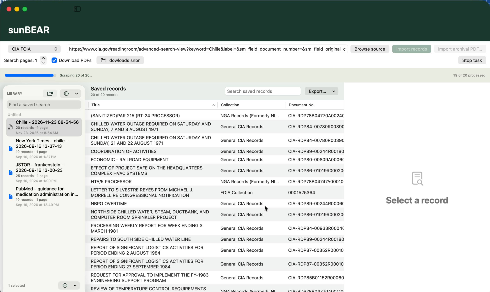
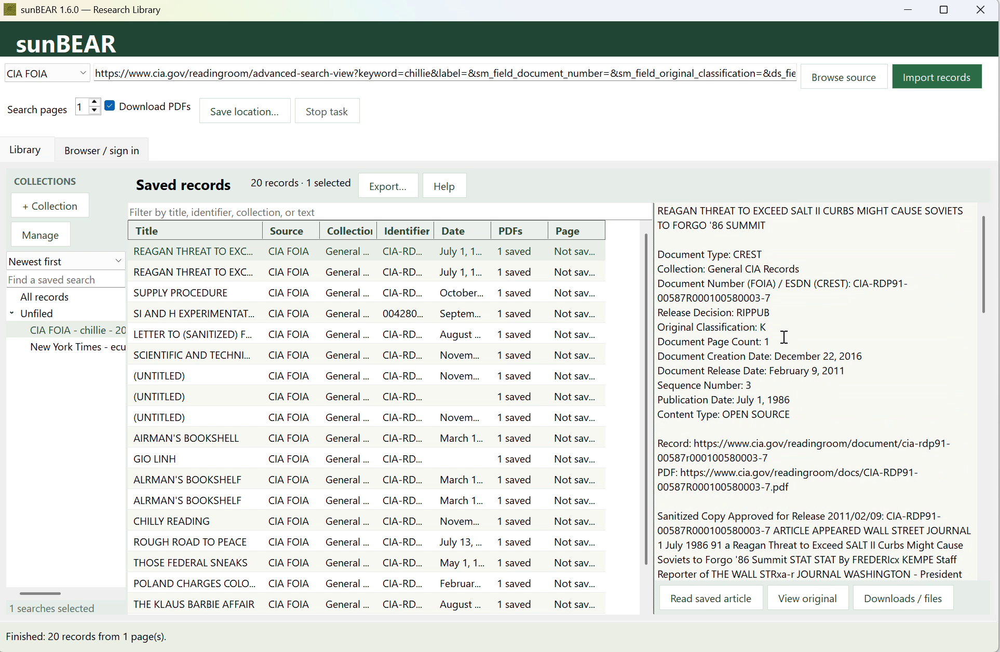
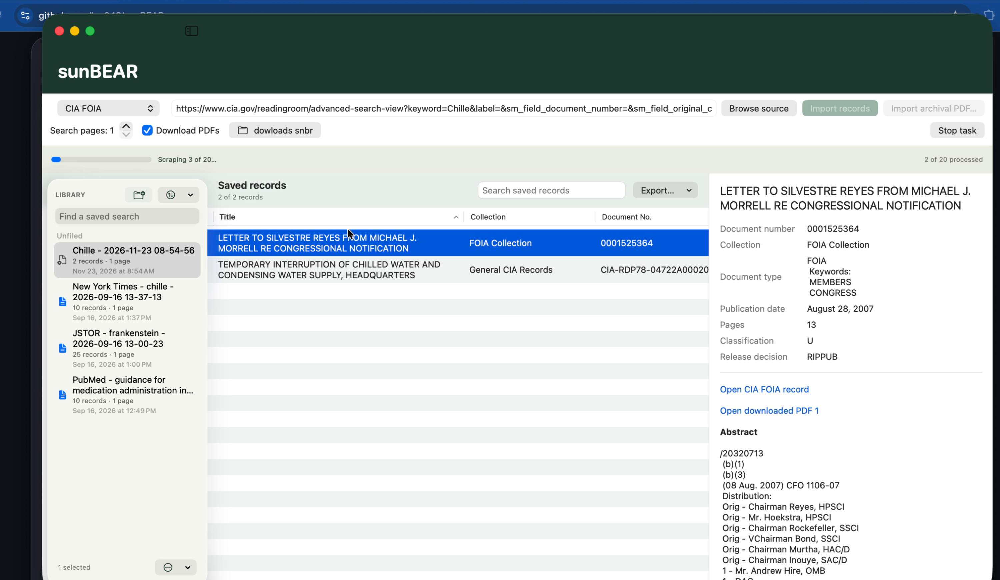
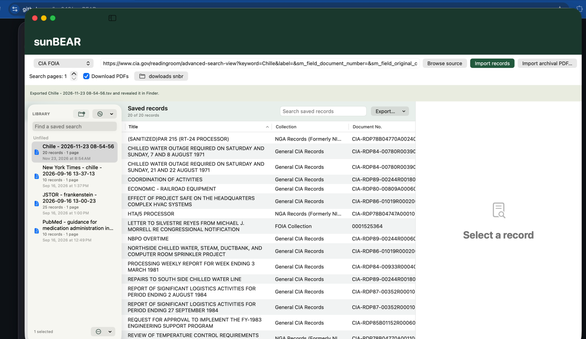
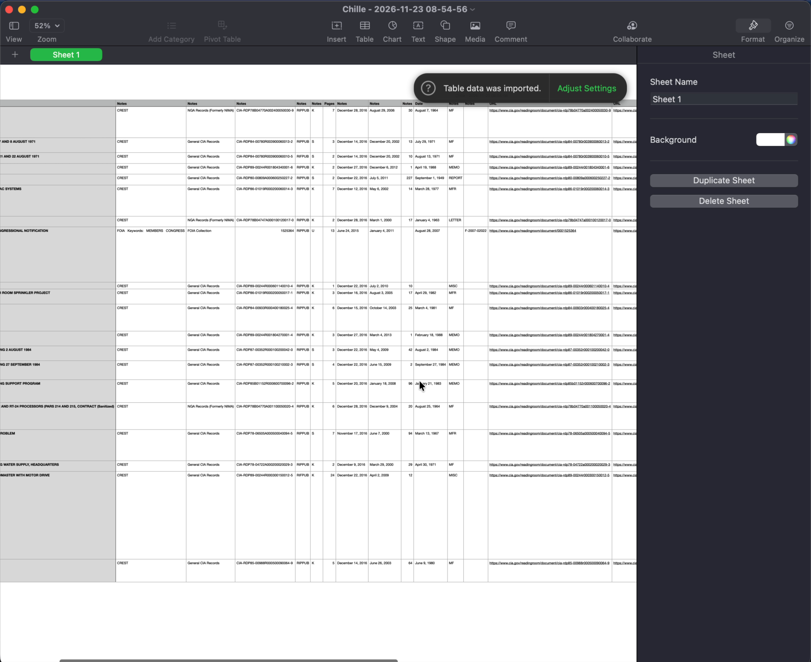
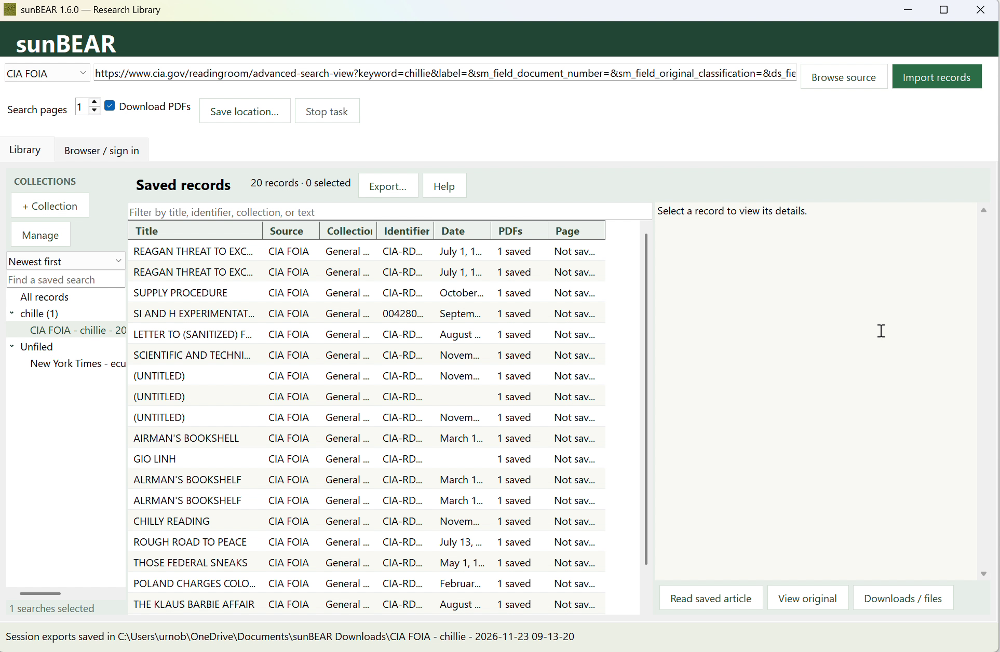
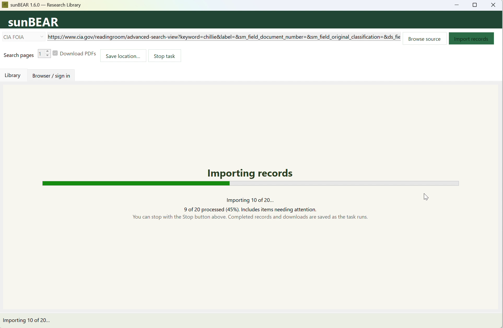
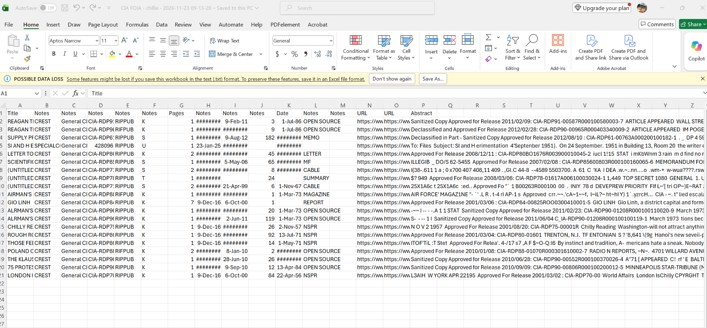

# sunBEAR

**Cross-platform desktop research library for macOS and Windows**

**Swift · SwiftUI · SwiftData · WebKit · C# · .NET 8 · Windows Forms · WebView2**

sunBEAR is an open-source application for discovering, collecting, organizing, and exporting research from public archives, academic databases, and newspapers. It combines source-aware imports, local research libraries, archival PDF metadata extraction, and spreadsheet- and EndNote-compatible exports.

The central engineering challenge is integrating research providers with different interfaces, document formats, authentication flows, and download restrictions into a consistent native desktop workflow.

## Application previews

| macOS | Windows |
| --- | --- |
|  |  |
| Native SwiftUI research library | Native Windows Forms research library |

## What sunBEAR does

- **Research organization:** Collections, saved searches, records, metadata, and locally saved source files in a three-column desktop library.
- **Source-aware importing:** Dedicated workflows for supported archival, academic, and newspaper sources.
- **Authenticated browsing:** Embedded browser sessions let users access content through their existing institutional or publisher accounts.
- **Document processing:** Import archival PDF bundles and propose editable metadata from their searchable text.
- **Interoperable exports:** Produce structured TSV files and EndNote-compatible research exports.
- **Local-first storage:** Keep records, paths, and downloads on the user's computer, in user-selected locations.

### Supported sources

CIA FOIA Reading Room · JSTOR · ERIC · PubMed and PubMed Central · U.S. National Archives · The New York Times · EBSCO Discovery Service · Local archival PDF bundles

Availability and supported operations vary by provider and platform. Changes to provider websites can require updates to import logic.

## Cross-platform architecture

| | macOS | Windows |
| --- | --- | --- |
| Language | Swift | C# |
| Interface | SwiftUI | Windows Forms |
| Browser integration | WebKit | WebView2 |
| Data layer | SwiftData | Native Windows implementation |
| Requirements | Xcode and macOS SDK | .NET 8 SDK and WebView2 Runtime |
| Documentation | [macOS guide](Documentation/MACOS.md) | [Windows guide](Windows/README.md) |

Both versions implement a research-library workflow using native platform technologies. They use separate local storage; libraries are **not** automatically synchronized or migrated between platforms.

### macOS implementation

The macOS application supports persistent embedded browser sessions, New York Times search-result imports, available NYT article text and optional offline HTML, EBSCO imports with PDF preference and available HTML fallback, archival PDF metadata drafts, session-organized downloads, and TSV/EndNote exports.

The archival importer retains each PDF bundle as a single record rather than splitting individual documents or pages. It proposes fields such as title, dates, document numbers, classification, case number, keywords, and description for manual review. **Image-only scans require OCR before import**; sunBEAR uses the PDF's existing searchable text layer.

### Windows implementation

Windows **1.6.0** includes the three-column library, saved-search filtering and sorting, bulk session actions, rendered New York Times search imports, optional offline article pages, and JSTOR/PubMed Central PDF preparation. Ctrl/Shift supports multiple saved-search selection.

See the [Windows feature comparison](Windows/MAC-PARITY.md) and [validation notes](Windows/VALIDATION.md) for platform-specific behavior and limitations.

## Research workflow gallery

### macOS: records and exports

| Record details | Export confirmation |
| --- | --- |
|  |  |
| Selected research record and metadata | Export workflow feedback |



*Structured archival research metadata exported as TSV and opened in Apple Numbers.*

### Windows: records, imports, and exports

| Record details | Import progress |
| --- | --- |
|  |  |
| Selected research record | Progress during a research import |



*Structured research metadata exported as TSV and opened in Microsoft Excel.*

## Build and test

### macOS

Open `sunBEAR/sunBEAR.xcodeproj` in Xcode, select the `sunBEAR` scheme, and run on **My Mac**.

To run the macOS test target:

```bash
xcodebuild test \
  -project sunBEAR/sunBEAR.xcodeproj \
  -scheme sunBEAR \
  -destination 'platform=macOS' \
  CODE_SIGNING_ALLOWED=NO \
  -only-testing:sunBEARTests
```

### Windows

Install the **.NET 8 SDK** and **Microsoft Edge WebView2 Runtime**, then:

```powershell
cd Windows
.\build.ps1
```

Launch `Windows/publish/sunBEAR.exe` with its companion files. Initial NuGet restore requires internet access. If PowerShell blocks scripts, consult your system's execution-policy settings and run only scripts you trust.

See [Windows setup](Windows/README.md) for further instructions.

## Access, privacy, and limitations

- Searches, records, and file paths are stored locally; downloads and available offline HTML go to user-selected folders.
- Publisher sign-in happens in the embedded browser; sunBEAR does not store account passwords.
- sunBEAR does **not** bypass paywalls, subscriptions, DRM, institutional permissions, or download restrictions.
- Captured article text is limited to material available in the user's authenticated session.
- Export and download functionality depends on provider permissions and locally installed applications.
- Extracted archival metadata is a **draft** and should be checked against the original document.

## Repository structure

- [`sunBEAR/`](sunBEAR/) — macOS application and tests
- [`Windows/`](Windows/) — Windows application, tests, build scripts, and documentation
- [`Documentation/`](Documentation/) — guides and application screenshots

Generated builds, downloaded research files, local databases, and temporary development files are excluded. Earlier source revisions remain available in Git history.

## License

[MIT](LICENSE). Original sunBEAR attribution is preserved.
